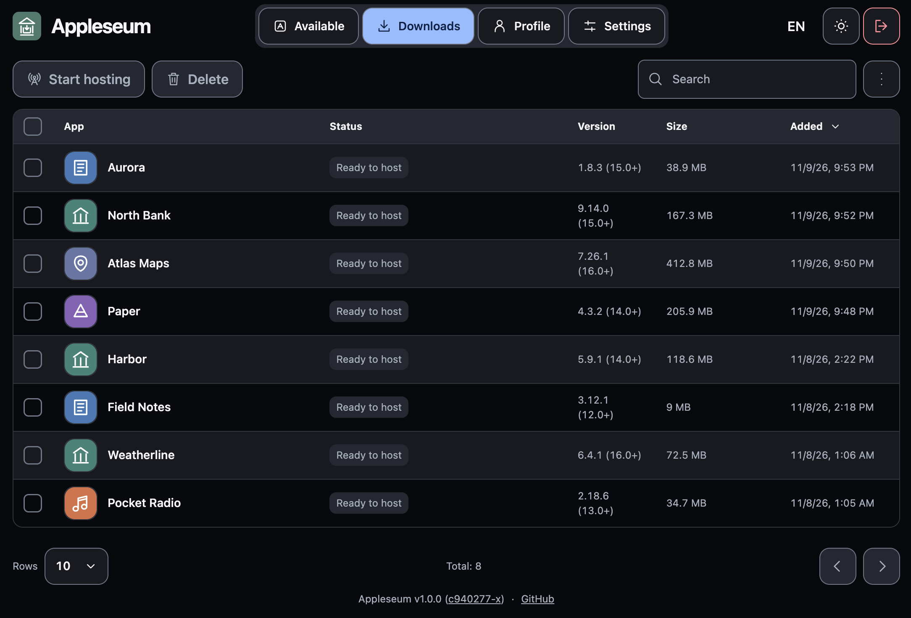

# Appleseum
[README на русском](README_RU.md) · [Apache License 2.0](LICENSE)

🚀 Your apps are here. Even apps delisted from the App Store — install them on iPhone/iPad without a cable.

[Why use Appleseum](#1-why-use-appleseum) · [Ways to use Appleseum](#2-modes) · [Install](#3-install) · [Using Appleseum after launch](#4-usage) · [Launch options](#5-options) · [FAQ](#6-faq) · [Similar projects](#7-similar-projects) · [Third-Party Dependencies](#8-third-party-dependencies)

## <a name="1-why-use-appleseum" /> [1.](#1-why-use-appleseum) Why use Appleseum
Appleseum is a utility for installing apps delisted from the App Store on your iPhone/iPad —
apps you can no longer find in search or download.

Typical situations:
- You move to a new iPhone/iPad, but apps you need do not transfer: they have been delisted from the App Store;
- You accidentally offload an app and cannot reinstall it.

> [!WARNING]
> Appleseum is not an official Apple utility. Use it at your own risk; the authors accept no responsibility for any problems.
>
> If you plan to sign in to an Apple account, make sure you are using the original version of Appleseum from this repository. Avoid copies on unfamiliar websites or access provided by strangers: a modified version could capture the credentials you enter and give others access to the account.



## <a name="2-modes" /> [2.](#2-modes) Ways to use Appleseum
Appleseum consists of a [server component](https://en.wikipedia.org/wiki/Web_server) and a web interface that opens in the built-in Safari browser on the iPhone or iPad you want to install apps on. Whether you need another device depends on how you choose to use the utility (a cable is never needed):

### <a name="2.1-local-mode" /> [2.1.](#2.1-local-mode) Local mode
> [!WARNING]
> For safe access over a local network, use your home network, which you control and trust. In both local modes, the web interface uses [http](https://en.wikipedia.org/wiki/HTTP) without encrypting all traffic. Appleseum checks the request's `Host` to protect against [DNS rebinding](https://en.wikipedia.org/wiki/DNS_rebinding), but an attacker carrying out a [man-in-the-middle attack](https://en.wikipedia.org/wiki/Man-in-the-middle_attack) within the network could replace the http page and steal your Apple account credentials if you enter them to sign in.

> [!NOTE]
> <a name="2.1-ish-notes" /> When running Appleseum's server component on an iPhone/iPad through iSH:
> - Make sure Airplane Mode and your [VPN](https://en.wikipedia.org/wiki/Virtual_private_network) are off before starting Appleseum and remain off while it is running;
> - To run in the background, Appleseum uses [iSH's standard location-based mechanism](https://github.com/ish-app/ish/wiki/Running-in-background) (the utility does not use location data in any way, which you can verify in the [source code](backend/cmd/appleseum/ish.go)). Allow location and Local Network access if prompted; even with these permissions, the OS may stop iSH after a while;
> - In this mode, the utility may run more slowly due to [emulation](https://en.wikipedia.org/wiki/Emulator) of 32-bit x86 code (`linux/386`).

### <a name="2.1.1-two-devices" /> [2.1.1.](#2.1.1-two-devices) Local mode: two devices
This is the main, recommended option. Both devices must be on the same local wireless network; usually, connecting them to the same Wi-Fi access point is enough.

#### <a name="2.1.1.1-server-device" /> First device: server component
Any device running Windows, macOS, Linux, iOS/iPadOS (via [iSH](https://github.com/ish-app/ish)) or Android (via [Termux](https://en.wikipedia.org/wiki/Termux)) will work — for example, a home computer, a laptop or another iPhone (such as your old one). For most users, a computer is the easiest place to run it.

[Install](#3-install) and start Appleseum. Links to the web interface should appear in the terminal output; you will need them in the next step.

#### <a name="2.1.1.2-target-device" /> Second device: iPhone/iPad where you need the apps
From the links shown on the first device, choose one with an address in your wireless network's [subnet](https://en.wikipedia.org/wiki/Subnetwork), then open it in Safari. If you are unsure which link to choose, try them one by one — at least one should open the web interface. For the next steps, see [how to use Appleseum after launch](#4-usage).

### <a name="2.1.2-on-device" /> [2.1.2.](#2.1.2-on-device) Local mode: one device
The server component runs on the same iPhone/iPad where you need the apps. Install [iSH from the App Store](https://apps.apple.com/us/app/ish-shell/id1436902243) on it. Within iSH, [install](#3.2-unix) and start Appleseum. Then open any link from the terminal output in Safari; e.g., the first one. Keep the [conditions for running iSH in the background](#2.1-ish-notes) in mind. For the next steps, see [how to use Appleseum after launch](#4-usage).

### <a name="2.2-public-server" /> [2.2.](#2.2-public-server) Public server
This mode is for a group of people you trust (family, friends or colleagues) and for your own access "from anywhere". For secure operation, access is available only over [https](https://en.wikipedia.org/wiki/HTTPS) (a valid [https certificate](https://en.wikipedia.org/wiki/Public_key_certificate) is required).

A typical scenario: someone hands you an iPhone and asks you to restore [apps delisted from the App Store](#1-why-use-appleseum). On that device, you open your personal server running Appleseum in Safari and quickly solve the problem. No extra software (including iSH) or other devices nearby are needed, and the happy owner declares you a tech wizard.

> [!WARNING]
> Features of this mode:
> - Not designed for heavy workloads or large-scale use by the general public; in particular, Apple may restrict or block access if too many requests come from one server;
> - Safety depends on the server operator.

#### <a name="2.2.1-server-device" /> First device: server component
The server can be located anywhere, for example on the internet.

[Install](#3-install) and start Appleseum in public mode:
- **Executable:** add `--public` to the launch command;
- **Docker:** place `--public` after the image name in `docker run`;
- **Docker Compose:** use the ready-made [compose.public.yaml](compose.public.yaml):
  ```sh
  curl -fsSLo compose.public.yaml https://raw.githubusercontent.com/hyperion-cs/appleseum/main/compose.public.yaml
  docker compose -f compose.public.yaml up -d
  ```

Set up a [reverse proxy](https://en.wikipedia.org/wiki/Reverse_proxy) for https access. It must forward requests to Appleseum's http port (`8080` by default), preserving the external hostname and port. Keep Appleseum's http port accessible only to the proxy. With the provided `compose.public.yaml` settings, the proxy connects to `127.0.0.1:8080` on the device running Docker.

#### <a name="2.2.2-target-device" /> Second device: iPhone/iPad where you need the apps
It must have network connectivity to the server. Open the server's configured https address in Safari. For the next steps, see [how to use Appleseum after launch](#4-usage).

#### <a name="2.2.3-sign-in-data-and-access" /> Sign-in data and access
Unlike in the local modes, you sign in to an Apple account separately for each browser session. Sign-in is also required to upload existing [`.ipa` files](https://en.wikipedia.org/wiki/.ipa). Clearing your browser's data removes the [key used to decrypt saved passwords](#6.2-account-data), so you will need to sign in again.

The administrator's login and temporary password appear in the server's terminal output, or `docker logs appleseum` for Docker. The administrator's password changes after each restart. Appleseum supports [launch options](#5-options); use `--help` to see the list.

## <a name="3-install" /> [3.](#3-install) Install
Assuming you have already [chosen a mode](#2-modes), you should now install Appleseum's server component. You can download and run the appropriate executable from the [latest release](https://github.com/hyperion-cs/appleseum/releases/latest). Alternatively, you can "install" the utility from the command line or use Docker:

### <a name="3.1-windows" /> [3.1.](#3.1-windows) Windows
Open PowerShell and paste:
```powershell
irm https://raw.githubusercontent.com/hyperion-cs/appleseum/main/install/windows.ps1 | iex
```

The installer will show the command for future launches.

### <a name="3.2-unix" /> [3.2.](#3.2-unix) macOS, Linux, iOS/iPadOS or Android
On iOS/iPadOS, use [iSH](https://apps.apple.com/us/app/ish-shell/id1436902243); on Android, use [Termux](https://github.com/termux/termux-app/releases).

Open the terminal and run:
```sh
u=https://raw.githubusercontent.com/hyperion-cs/appleseum/main/install/unix.sh; (curl -fsSL $u || wget -qO- $u) | sh
```

The installer will show the command for future launches.

### <a name="3.3-docker" /> [3.3.](#3.3-docker) Docker
You can also run Appleseum with [Docker](https://en.wikipedia.org/wiki/Docker_%28software%29):
```sh
docker run -d --name appleseum --network host \
  -v appleseum-data:/data ghcr.io/hyperion-cs/appleseum:latest
```

To see the links to the web interface, check the utility's output:
```sh
docker logs appleseum
```

Your downloads and settings are stored in the `appleseum-data` volume,
which is preserved when you remove the container.
`docker stop appleseum` stops the server; `docker start appleseum` starts it again.

#### <a name="3.3.1-keep-it-running-with-docker-compose" /> [3.3.1.](#3.3.1-keep-it-running-with-docker-compose) Docker Compose
Basic Compose templates are provided, and you can edit them to suit your needs. For local mode, save the file and start the server:
```sh
curl -fsSLo compose.local.yaml https://raw.githubusercontent.com/hyperion-cs/appleseum/main/compose.local.yaml
docker compose -f compose.local.yaml up -d
```

[Public mode](#2.2-public-server) uses `compose.public.yaml`.
Both files use the same `appleseum-data` volume; the container restarts with Docker.
When switching from `docker run` to Compose, stop and remove the previous
`appleseum` container.

### <a name="3.4-updates" /> [3.4.](#3.4-updates) Updating the utility
- **Executable:** stop the utility and rerun the installer or manually replace the executable. The installer changes only that file, leaving your data untouched. Run the new version with the same data folder to keep your library and settings;
- **Docker:** update the image and recreate the container with the same volume and launch options. With Compose, repeat your previous launch command, adding `--pull always` to fetch the new image.

Appleseum will update the storage format automatically by applying the appropriate [migrations](https://en.wikipedia.org/wiki/Schema_migration) if needed.
Updating does not affect apps already installed on your iPhone/iPad.

## <a name="4-usage" /> [4.](#4-usage) Using Appleseum after launch
Assuming you have already [installed Appleseum](#3-install) and also [started the server component and opened the web interface](#2-modes), you can now continue:

1. On first use, you will probably need to sign in to an Apple account. In either local mode, you can skip this step if you plan to upload existing `.ipa` files to the library for installation. Enter a [two-factor authentication (2FA)](https://en.wikipedia.org/wiki/Multi-factor_authentication) code if prompted during sign-in;
2. Add the apps you need to the local library in one of two ways:
   - **From the App Store catalog:** in "Available", select the apps you want and choose "Download";
   - <a name="4-ipa-import" /> **Manually:** upload `.ipa` files in "Downloads" (choose "More" → "Import .ipa" → "Choose files", or use [drag and drop](https://en.wikipedia.org/wiki/Drag_and_drop)).
3. In "Downloads", select the apps to install and choose "Start hosting";
4. In the window that appears, choose "Install" and confirm installation when iOS/iPadOS asks;
5. Wait for Appleseum to confirm that the [transfer is complete](#4-ipa-transfer), then go to the Home Screen and check that the apps are installed (if they are still installing, wait until they finish).

> [!NOTE]
> <a name="4-ipa-transfer" /> Keep Appleseum's server component running until the `.ipa` files have finished transferring to the iPhone/iPad; progress is shown in the web interface. Ctrl+C in the terminal stops the utility.

## <a name="5-options" /> [5.](#5-options) Launch options

| Name                    | Type          | Default                          | Description                                                                                                                                                                                                                                                                                                                              |
| ----------------------- | ------------- | -------------------------------- | ---------------------------------------------------------------------------------------------------------------------------------------------------------------------------------------------------------------------------------------------------------------------------------------------------------------------------------------- |
| <code>--http port&#124;ip:port</code>  | <code>int&#124;string</code> | `8080`                           | http listener for frontend, our [API](https://en.wikipedia.org/wiki/API) and `.ipa` files. If only a port is specified, the server listens on all network interfaces.                                                                                                                                                                                      |
| <code>--https port&#124;ip:port</code> | <code>int&#124;string</code> | `8443`; disabled with `--public` | https listener for [installation manifests](https://en.wikipedia.org/wiki/Manifest_file), using a [self-signed certificate](https://en.wikipedia.org/wiki/Self-signed_certificate). If only a port is specified, the server listens on all network interfaces. Cannot be specified with `--public`.                                                     |
| <code>--localhost-resolver bonjour&#124;nip</code> | `string` | `bonjour` | Hostname resolver for same-device installation in iSH.<br>`bonjour`: use the device's local [Bonjour](https://en.wikipedia.org/wiki/Bonjour_%28software%29) service (default).<br>`nip`: resolve the local ip via nip.io.<br>Warning: `nip` uses third-party DNS outside this device and Apple; no http requests are sent to nip.io. |
| `--public`              | `bool`        | `false`                          | Use separate browser sessions. Disable the built-in https listener and serve everything on `--http`. Requires a reverse proxy with a valid https certificate for the entire utility. Cannot be combined with `--debug=web` or `--https`. See [section 2.2](#2.2-public-server). |
| `--shared-library`      | `bool`        | `false`                          | Share the local library among all users; otherwise, show only the current account’s apps. Requires `--public`. Other accounts’ apps remain read-only.                                                                                                                                                                                                                                     |
| `--data path` | `string` | Windows: `%LOCALAPPDATA%\Appleseum\data`<br>macOS: `~/Library/Application Support/Appleseum`<br>Linux, Android (Termux), iOS/iPadOS (iSH): `~/.local/share/appleseum` | Runtime data directory. Linux, Android (Termux) and iOS/iPadOS (iSH) respect an absolute `XDG_DATA_HOME`. The selected absolute path is printed at startup. |
| `--settings`            | `bool`        | `false`                          | Enable the settings tab and its API.                                                                                                                                                                                                                                                                                         |
| <code>--debug[=web&#124;raw]</code>    | `string`      | —                                | `--debug` or `--debug=web`: enable the debug tab, http logs and internal errors. Web logs are stored in `logs/` inside the data directory. `--debug=raw`: write process, network and database diagnostics to `debug.log` in the current directory, without the debug tab. Only web mode is incompatible with `--public`. |
| `-h, --help`            | —             | —                                | Show this help and exit.                                                                                                                                                                                                                                                                                                                 |

## <a name="6-faq" /> [6.](#6-faq) FAQ
#### <a name="6.1-public-server" /> [6.1.](#6.1-public-server) Is there a public Appleseum server run by the authors?
No. In that case, you could not verify that the server was running the code from this repository without any modifications. You should also consider the limitations of [public mode](#2.2-public-server).

#### <a name="6.2-account-data" /> [6.2.](#6.2-account-data) Could my Apple account be stolen?
No, as long as you follow the recommendations in this README. The original version uses your credentials only to communicate with Apple's servers and does not send them to the project's authors and/or unrelated services; you can check this in the [source code](https://github.com/hyperion-cs/appleseum). The authors devote substantial time to security, taking all necessary steps (within their capabilities) to prevent data leaks. Appleseum does not store passwords in plaintext. And in public mode, the decryption key is saved only in the browser on the user's device, i.e., not stored on the server.

#### <a name="6.3-verification-code" /> [6.3.](#6.3-verification-code) Will I need to enter a 2FA code every time?
Usually, a code is needed only on the first sign-in. To Apple, Appleseum looks like a real device running macOS, and its device parameters are saved locally between launches.

#### <a name="6.4-catalog" /> [6.4.](#6.4-catalog) Which apps are available in the catalog?
After you sign in to your Apple account, the catalog gives you access to every app you have ever obtained with that account, regardless of which device you installed it on. This includes apps delisted from the App Store; installing them is Appleseum's main purpose. Apple counts apps obtained for free as "purchases" too.

#### <a name="6.5-other-account-apps" /> [6.5.](#6.5-other-account-apps) Can I install an app that is not in my Apple account's purchase history?
Yes. In Appleseum, you can download it using another Apple account whose purchase history includes it, or [import an existing `.ipa` file](#4-ipa-import). You can collect apps from different Apple accounts in the local library and install them even on an iPhone/iPad that has never had them before. There is no need to switch accounts on the target device.

#### <a name="6.6-update-delisted-apps" /> [6.6.](#6.6-update-delisted-apps) Can I update an app delisted from the App Store?
Yes, but for now you need to uninstall the old version before installing the new one, which may erase the app's local data. We are working on a way to update apps without uninstalling them.

#### <a name="6.7-sharing-ipa" /> [6.7.](#6.7-sharing-ipa) Is it safe to share my `.ipa` files?
For new downloads, Appleseum removes the account login (email address or phone number), name, full account ID and download dates from `.ipa` [metadata](https://en.wikipedia.org/wiki/Metadata). Apple licenses remain unchanged, so the file may still contain the account holder's first and last name and part of their account ID. These details are not intended for signing in to the Apple account or unlocking a device, but they reveal some personal information. Existing library files and imported `.ipa` files are left unchanged and may contain more personal information.

#### <a name="6.8-compatibility" /> [6.8.](#6.8-compatibility) Which iOS/iPadOS versions does Appleseum work with?
App installation through Appleseum has been successfully tested in [all modes](#2-modes) on Apple devices running the iOS/iPadOS versions listed below. App files must also be compatible with your device: they usually are, but there may be restrictions, e.g., based on the OS version.

| Device | Tested OS versions |
| ------ | ------------------ |
| iPhone | iOS 17.3.1, 26.5.2, 27.2.1 |
| iPad   | iPadOS 26.7.1      |

#### <a name="6.9-offline" /> [6.9.](#6.9-offline) Can I use Appleseum without an internet connection or an Apple sign-in?
Yes, in either local mode. You can [import existing `.ipa` files](#4-ipa-import) or use files already in the library to install apps without an internet connection or signing in to Apple.

#### <a name="6.10-distribution" /> [6.10.](#6.10-distribution) How is Appleseum distributed?
Appleseum is written in pure [Go](https://en.wikipedia.org/wiki/Go_%28programming_language%29) and comes as a single lightweight, self-contained executable. Installation methods are described in [section 3](#3-install).

#### <a name="6.11-internals" /> [6.11.](#6.11-internals) Where can I learn more about how Appleseum works internally?
- [Article on Habr](https://habr.com/ru/articles/1109020/) [[Gist mirror](https://gist.github.com/hyperion-cs/0e22b34837b834e43de1e99f92e7ad7a)]

#### <a name="6.12-build-from-source" /> [6.12.](#6.12-build-from-source) How can I build Appleseum from source?
You can use the [release workflow](.github/workflows/release.yml) as a reference.

## <a name="7-similar-projects" /> [7.](#7-similar-projects) Similar projects
- [majd/ipatool](https://github.com/majd/ipatool);
- [Lakr233/Asspp](https://github.com/Lakr233/Asspp).

## <a name="8-third-party-dependencies" /> [8.](#8-third-party-dependencies) Third-Party Dependencies
- [andybalholm/brotli](https://github.com/andybalholm/brotli);
- [klauspost/compress](https://github.com/klauspost/compress);
- [gofrs/flock](https://github.com/gofrs/flock);
- [howett.net/plist](https://pkg.go.dev/howett.net/plist);
- [modernc.org/sqlite](https://pkg.go.dev/modernc.org/sqlite);
- [refraction-networking/utls](https://github.com/refraction-networking/utls);
- [google/uuid](https://github.com/google/uuid).
