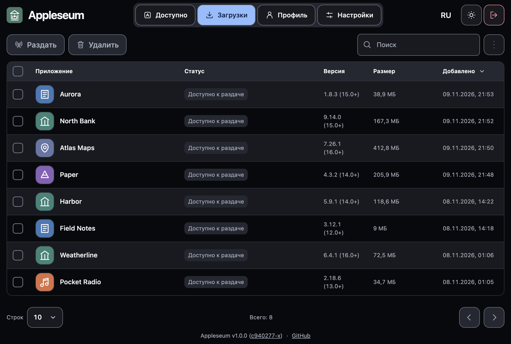

# Appleseum
[README in English](README.md) · [Apache License 2.0](LICENSE)

🚀 Ваши приложения здесь. Даже те, которые уже недоступны в App Store — устанавливайте их на iPhone/iPad, без кабеля.

[Зачем нужен Appleseum](#1-why-use-appleseum) · [Варианты работы](#2-modes) · [Установка](#3-install) · [Как пользоваться запущенным Appleseum](#4-usage) · [Параметры запуска](#5-options) · [FAQ](#6-faq) · [Похожие проекты](#7-similar-projects) · [Сторонние зависимости](#8-third-party-dependencies)

## <a name="1-why-use-appleseum" /> [1.](#1-why-use-appleseum) Зачем нужен Appleseum
Утилита Appleseum позволяет установить на iPhone/iPad приложения, которые уже недоступны
в App Store: те, которые больше нельзя ни найти через поиск, ни скачать.

Типичные ситуации:
- Вы перешли на новый iPhone/iPad, но нужные приложения не перенеслись: они уже недоступны в App Store;
- Вы случайно сгрузили приложение, а установить его снова не получается.

> [!WARNING]
> Appleseum не является официальной утилитой Apple. Вы используете её на свой страх и риск; авторы не несут ответственности за возможные проблемы.
>
> Если собираетесь войти в аккаунт Apple, убедитесь, что используете оригинальную версию Appleseum из этого репозитория. Избегайте копий со случайных сайтов и доступа от незнакомых людей: изменённая версия может перехватить введённые данные входа и дать посторонним доступ к аккаунту.



## <a name="2-modes" /> [2.](#2-modes) Варианты работы
Appleseum состоит из [серверной части](https://en.wikipedia.org/wiki/Web_server) и веб-интерфейса, который открывается в штатном браузере Safari — на iPhone или iPad, на который вы хотите установить приложения. Нужно ли для работы ещё одно устройство, зависит от выбранного способа (кабель никогда не потребуется):

### <a name="2.1-local-mode" /> [2.1.](#2.1-local-mode) Локально
> [!WARNING]
> Для безопасной работы по локальной сети используйте домашнюю сеть, которую вы контролируете и которой доверяете. В локальных режимах веб-интерфейс работает по [http](https://en.wikipedia.org/wiki/HTTP) без шифрования всего трафика. Appleseum проверяет `Host` запросов для защиты от [DNS rebinding](https://en.wikipedia.org/wiki/DNS_rebinding), но при атаках вида ["человек посередине"](https://en.wikipedia.org/wiki/Man-in-the-middle_attack) внутри сети злоумышленник может подменить http-страницу и украсть данные аккаунта Apple, если вы введёте их при входе.

> [!NOTE]
> <a name="2.1-ish-notes" /> При запуске серверной части Appleseum на iPhone/iPad через iSH:
> - Убедитесь, что перед запуском и во время работы выключены авиарежим и [VPN](https://en.wikipedia.org/wiki/Virtual_private_network);
> - Для работы в фоне Appleseum использует [штатный механизм iSH через геолокацию](https://github.com/ish-app/ish/wiki/Running-in-background) (данные геолокации утилита никак не использует — это можно проверить в [исходном коде](backend/cmd/appleseum/ish.go)). Разрешите доступ к геолокации и локальной сети, если появятся соотв. запросы; даже с этими разрешениями ОС может остановить iSH спустя некоторое время;
> - В этом режиме утилита может работать медленнее из-за [эмуляции](https://en.wikipedia.org/wiki/Emulator) 32-битного кода x86 (`linux/386`).

### <a name="2.1.1-two-devices" /> [2.1.1.](#2.1.1-two-devices) Локально: два устройства
Это основной и рекомендуемый вариант. Оба устройства должны находиться в одной локальной беспроводной сети — обычно для этого достаточно подключить их к одной точке доступа Wi-Fi.

#### <a name="2.1.1.1-server-device" /> Первое устройство: серверная часть
Подойдёт любое с Windows, macOS, Linux, iOS/iPadOS (через [iSH](https://github.com/ish-app/ish)) или Android (через [Termux](https://en.wikipedia.org/wiki/Termux)) — напр., домашний компьютер, ноутбук или другой iPhone (в т.ч. ваш старый). Для большинства пользователей проще всего запустить утилиту на компьютере.

[Установите](#3-install) и запустите Appleseum. В выводе терминала должны появиться ссылки для входа в веб-интерфейс — они понадобятся на следующем шаге.

#### <a name="2.1.1.2-target-device" /> Второе устройство: iPhone/iPad, где нужны приложения
Из ссылок, показанных на первом устройстве, выберите одну с адресом из [подсети](https://en.wikipedia.org/wiki/Subnetwork) вашей беспроводной сети и откройте её в Safari. Если не знаете, какая подходит, попробуйте ссылки по очереди — как минимум одна из них должна открыть веб-интерфейс. Дальнейшие действия описаны в разделе [о работе с запущенной утилитой](#4-usage).

### <a name="2.1.2-on-device" /> [2.1.2.](#2.1.2-on-device) Локально: одно устройство
Серверная часть работает на том же iPhone/iPad, где нужны приложения. Установите на него [iSH из App Store](https://apps.apple.com/us/app/ish-shell/id1436902243). Затем внутри него [установите](#3.2-unix) и запустите Appleseum. Откройте в Safari любую ссылку из вывода терминала; напр., первую. Учитывайте [условия работы iSH в фоне](#2.1-ish-notes). Дальнейшие действия описаны в разделе [о работе с запущенной утилитой](#4-usage).

### <a name="2.2-public-server" /> [2.2.](#2.2-public-server) Публичный сервер
Этот режим подходит для доверенного круга лиц (родных, друзей или коллег) и для личного доступа "из любого места". В целях безопасной работы доступ возможен только по [https](https://en.wikipedia.org/wiki/HTTPS) (нужен валидный [https-сертификат](https://en.wikipedia.org/wiki/Public_key_certificate)).

Типичный сценарий: вам дают iPhone и просят вернуть [приложения, которые уже недоступны в App Store](#1-why-use-appleseum). На этом устройстве вы открываете в Safari свой личный сервер с Appleseum и быстро решаете проблему. Установка дополнительного ПО (в т.ч. iSH) и другие устройства рядом не нужны, а довольный владелец телефона нарекает вас техношаманом.

> [!WARNING]
> Особенности этого режима:
> - Не рассчитан на большую нагрузку и массовое использование посторонними пользователями; в т.ч., Apple может ограничить или заблокировать доступ при большом числе запросов с одного сервера;
> - Безопасность зависит от владельца сервера.

#### <a name="2.2.1-server-device" /> Первое устройство: серверная часть
Сервер может находиться где угодно, напр., в Интернете.

[Установите](#3-install) и запустите Appleseum в публичном режиме:
- **Исполняемый файл:** добавьте `--public` к команде запуска;
- **Docker:** укажите `--public` после имени образа в `docker run`;
- **Docker Compose:** используйте готовый [compose.public.yaml](compose.public.yaml):
  ```sh
  curl -fsSLo compose.public.yaml https://raw.githubusercontent.com/hyperion-cs/appleseum/main/compose.public.yaml
  docker compose -f compose.public.yaml up -d
  ```

Настройте [обратный прокси](https://en.wikipedia.org/wiki/Reverse_proxy) для https-доступа. Он должен передавать запросы на http-порт Appleseum (по умолчанию `8080`), сохраняя внешнее имя хоста и порт. Сам http-порт Appleseum должен быть доступен только прокси. С настройками готового `compose.public.yaml` прокси должен обращаться к `127.0.0.1:8080` на устройстве с Docker.

#### <a name="2.2.2-target-device" /> Второе устройство: iPhone/iPad, где нужны приложения
Нужна сетевая связность с сервером. Откройте в Safari настроенный https-адрес сервера. Дальнейшие действия описаны в разделе [о работе с запущенной утилитой](#4-usage).

#### <a name="2.2.3-sign-in-data-and-access" /> Данные для входа и доступ
В отличие от локальных режимов, здесь вы входите в аккаунт Apple отдельно для каждой браузерной сессии. Вход нужен и для добавления готовых файлов [`.ipa`](https://en.wikipedia.org/wiki/.ipa). После очистки данных браузера потребуется новый вход: вместе с ними удаляется [ключ расшифровки сохранённых паролей](#6.2-account-data).

Логин и временный пароль администратора видны в терминале сервера, а при запуске через Docker — в `docker logs appleseum`. Пароль администратора меняется при каждом перезапуске. Утилита поддерживает [параметры запуска](#5-options); их список также доступен через `--help`.

## <a name="3-install" /> [3.](#3-install) Установка
Предположим, вы уже [выбрали режим работы](#2-modes). Теперь следует установить серверную часть утилиты: достаточно скачать и запустить подходящий исполняемый файл из [актуального релиза](https://github.com/hyperion-cs/appleseum/releases/latest). Также Appleseum можно "установить" через командную строку или использовать Docker:

### <a name="3.1-windows" /> [3.1.](#3.1-windows) Windows
Откройте PowerShell и вставьте:
```powershell
irm https://raw.githubusercontent.com/hyperion-cs/appleseum/main/install/windows.ps1 | iex
```

Команду для дальнейшего запуска подскажет установщик.

### <a name="3.2-unix" /> [3.2.](#3.2-unix) macOS, Linux, iOS/iPadOS или Android
На iOS/iPadOS используйте [iSH](https://apps.apple.com/us/app/ish-shell/id1436902243), на Android — [Termux](https://github.com/termux/termux-app/releases).

Откройте терминал и выполните:
```sh
u=https://raw.githubusercontent.com/hyperion-cs/appleseum/main/install/unix.sh; (curl -fsSL $u || wget -qO- $u) | sh
```

Команду для дальнейшего запуска подскажет установщик.

### <a name="3.3-docker" /> [3.3.](#3.3-docker) Docker
Appleseum также можно запустить через [Docker](https://en.wikipedia.org/wiki/Docker_%28software%29):
```sh
docker run -d --name appleseum --network host \
  -v appleseum-data:/data ghcr.io/hyperion-cs/appleseum:latest
```

Чтобы увидеть ссылки для входа в веб-интерфейс, посмотрите вывод утилиты:
```sh
docker logs appleseum
```

Скачанные приложения и настройки хранятся в томе `appleseum-data`, который
сохраняется при удалении контейнера. Команда `docker stop appleseum`
останавливает сервер, `docker start appleseum` запускает его снова.

#### <a name="3.3.1-keep-it-running-with-docker-compose" /> [3.3.1.](#3.3.1-keep-it-running-with-docker-compose) Docker Compose
Для Compose подготовлены базовые шаблоны, которые можно редактировать под свои задачи. Для локального режима сохраните файл и запустите сервер:
```sh
curl -fsSLo compose.local.yaml https://raw.githubusercontent.com/hyperion-cs/appleseum/main/compose.local.yaml
docker compose -f compose.local.yaml up -d
```

Для [публичного режима](#2.2-public-server) предусмотрен `compose.public.yaml`.
Оба файла используют один том `appleseum-data`; контейнер перезапускается вместе с Docker.
При переходе с `docker run` на Compose остановите и удалите прежний контейнер
`appleseum`.

### <a name="3.4-updates" /> [3.4.](#3.4-updates) Обновление утилиты
- **Исполняемый файл:** остановите утилиту и повторно запустите установщик либо вручную замените исполняемый файл. Установщик меняет только этот файл, не затрагивая данные. Новую версию запускайте с прежней папкой данных, чтобы сохранить библиотеку и настройки;
- **Docker:** обновите образ и создайте контейнер заново с прежним томом и параметрами запуска. В Compose повторите прежнюю команду запуска, добавив `--pull always` для скачивания нового образа.

При необходимости Appleseum сам обновит формат хранения данных через соответствующие [миграции](https://en.wikipedia.org/wiki/Schema_migration).
Обновление не затрагивает уже установленные на iPhone/iPad приложения.

## <a name="4-usage" /> [4.](#4-usage) Как пользоваться запущенным Appleseum
Предположим, вы уже [установили Appleseum](#3-install), а также [запустили серверную часть и открыли веб-интерфейс](#2-modes). Теперь можно продолжить:

1. При первом использовании, скорее всего, потребуется войти в аккаунт Apple. В локальных режимах этот шаг можно пропустить, если вы собираетесь вручную добавить готовые `.ipa` в библиотеку для установки. Если при входе появится запрос кода [двухфакторной аутентификации (2FA)](https://en.wikipedia.org/wiki/Multi-factor_authentication), введите его;
2. Добавьте нужные приложения в локальную библиотеку одним из способов:
   - **Из каталога App Store:** в разделе "Доступно" выберите нужные приложения и нажмите "Скачать";
   - <a name="4-ipa-import" /> **Вручную:** добавьте файлы `.ipa` в раздел "Загрузки" (откройте "Ещё" → "Импорт .ipa" → "Выбрать файлы" или используйте [drag-and-drop](https://en.wikipedia.org/wiki/Drag_and_drop)).
3. В разделе "Загрузки" выберите приложения для установки и нажмите "Раздать";
4. В появившемся окне нажмите "Установить" и подтвердите установку, когда iOS/iPadOS предложит это сделать;
5. Дождитесь сообщения Appleseum о [завершении передачи](#4-ipa-transfer), затем перейдите на экран "Домой" и убедитесь, что приложения установлены (если установка ещё идёт, дождитесь её окончания).

> [!NOTE]
> <a name="4-ipa-transfer" /> Серверная часть Appleseum должна работать до конца передачи файлов `.ipa` на iPhone/iPad; прогресс этого этапа виден в веб-интерфейсе. Сочетание Ctrl+C в терминале останавливает утилиту.

## <a name="5-options" /> [5.](#5-options) Параметры запуска
| Параметр                | Тип           | По умолчанию                  | Описание                                                                                                                                                                                                                                                                                                                                                      |
| ----------------------- | ------------- | ----------------------------- | ------------------------------------------------------------------------------------------------------------------------------------------------------------------------------------------------------------------------------------------------------------------------------------------------------------------------------------------------------------- |
| `--http port\|ip:port`  | `int\|string` | `8080`                        | http-сервер для веб-интерфейса, [API](https://en.wikipedia.org/wiki/API) утилиты и файлов `.ipa`. Если указан только порт, сервер принимает соединения на всех сетевых интерфейсах.                                                                                                                                                                  |
| `--https port\|ip:port` | `int\|string` | `8443`; отключён с `--public` | https-сервер для [манифестов установки](https://en.wikipedia.org/wiki/Manifest_file) с [самоподписанным сертификатом](https://en.wikipedia.org/wiki/Self-signed_certificate). Если указан только порт, сервер принимает соединения на всех сетевых интерфейсах. Нельзя указывать вместе с `--public`.                                             |
| `--localhost-resolver bonjour\|nip` | `string` | `bonjour` | Способ определения имени устройства для установки на том же iPhone/iPad через iSH.<br>`bonjour`: локальная служба [Bonjour](https://en.wikipedia.org/wiki/Bonjour_%28software%29) устройства (по умолчанию).<br>`nip`: определение локального ip через nip.io.<br>Внимание: `nip` использует сторонний DNS за пределами устройства и серверов Apple; http-запросы к nip.io не отправляются. |
| `--public`              | `bool`        | `false`                       | Отдельные браузерные сессии. Встроенный https-сервер отключается, всё обслуживается через `--http`. Требуется обратный прокси с действующим https-сертификатом для доступа ко всей утилите. Нельзя сочетать с `--debug=web` или `--https`. Подробнее — в [разделе 2.2](#2.2-public-server). |
| `--shared-library`      | `bool`        | `false`                       | Общая локальная библиотека для всех пользователей; иначе видны только приложения текущего аккаунта. Требует `--public`. Приложения других аккаунтов доступны без права изменения.                                                                                                                                                                                                                              |
| `--data path` | `string` | Windows: `%LOCALAPPDATA%\Appleseum\data`<br>macOS: `~/Library/Application Support/Appleseum`<br>Linux, Android (Termux), iOS/iPadOS (iSH): `~/.local/share/appleseum` | Папка данных утилиты. Linux, Android (Termux) и iOS/iPadOS (iSH) учитывают абсолютный путь в `XDG_DATA_HOME`. Выбранный абсолютный путь выводится при запуске. |
| `--settings`            | `bool`        | `false`                       | Включить раздел "Настройки" и соотв. API.                                                                                                                                                                                                                                                                                                        |
| `--debug[=web\|raw]`    | `string`      | —                             | `--debug` или `--debug=web`: включить раздел "Отладка", журналы http и отображение внутренних ошибок. Веб-журналы сохраняются в `logs/` внутри папки данных. `--debug=raw`: записывать диагностику процесса, сети и базы данных в `debug.log` в текущей папке без раздела "Отладка". С `--public` несовместим только веб-режим. |
| `-h, --help`            | —             | —                             | Показать справку и завершить работу.                                                                                                                                                                                                                                                                                                                          |

## <a name="6-faq" /> [6.](#6-faq) FAQ
#### <a name="6.1-public-server" /> [6.1.](#6.1-public-server) Есть ли публичный сервер Appleseum от авторов утилиты?
Нет. В этом случае нельзя убедиться, что на сервере запущен код из этого репозитория без каких-либо изменений. Также следует учитывать ограничения [публичного режима](#2.2-public-server).

#### <a name="6.2-account-data" /> [6.2.](#6.2-account-data) Не украдут ли мой аккаунт Apple?
Нет, если соблюдать рекомендации этого README. Оригинальная версия использует данные входа только для взаимодействия с серверами Apple и не передаёт их авторам проекта и/или посторонним сервисам; это можно проверить по [исходному коду](https://github.com/hyperion-cs/appleseum). Авторы уделяют безопасности много времени, делают всё необходимое (в рамках их возможностей), чтобы предотвратить утечки данных. Appleseum не хранит пароли в открытом виде. А в публичном режиме ключ расшифровки сохраняется только в браузере на устройстве пользователя, т.е. не хранится на сервере.

#### <a name="6.3-verification-code" /> [6.3.](#6.3-verification-code) Нужно ли каждый раз вводить код 2FA?
Обычно код нужен только при первом входе. Для Apple Appleseum выглядит как настоящее устройство с macOS; его параметры сохраняются локально между запусками.

#### <a name="6.4-catalog" /> [6.4.](#6.4-catalog) Какие приложения доступны в каталоге?
После входа в аккаунт Apple в каталоге доступны все приложения, которые вы когда-либо получали с этого аккаунта, независимо от того, на каком устройстве их устанавливали. В список входят и приложения, которые уже недоступны в App Store: их установка — основное назначение Appleseum. Apple считает "покупками" и полученные бесплатно приложения.

#### <a name="6.5-other-account-apps" /> [6.5.](#6.5-other-account-apps) Можно ли установить приложение, которого нет в истории покупок моего аккаунта Apple?
Да. В Appleseum можно скачать его под другим аккаунтом Apple, в истории покупок которого оно есть, или [импортировать готовый файл `.ipa`](#4-ipa-import). В локальной библиотеке можно собирать приложения с разных аккаунтов Apple и устанавливать их даже на iPhone/iPad, где их никогда не было. Менять аккаунт на конечном устройстве не требуется.

#### <a name="6.6-update-delisted-apps" /> [6.6.](#6.6-update-delisted-apps) Можно ли обновить приложение, которое уже недоступно в App Store?
Да, но пока для этого нужно удалить старую версию с устройства, что может привести к потере локальных данных приложения. Мы работаем над возможностью обновления без удаления.

#### <a name="6.7-sharing-ipa" /> [6.7.](#6.7-sharing-ipa) Безопасно ли делиться своими файлами `.ipa`?
При новых скачиваниях Appleseum удаляет из [метаданных](https://en.wikipedia.org/wiki/Metadata) файла `.ipa` логин (эл. почту или телефон), имя, полный ID аккаунта и даты скачивания. Лицензии Apple сохраняются без изменений, поэтому в файле могут остаться имя и фамилия владельца аккаунта и часть его ID. Эти сведения не предназначены для входа в аккаунт Apple или разблокировки устройства, но они раскрывают часть персональных данных. Готовые файлы библиотеки и импортированные файлы `.ipa` сохраняются без изменений и могут содержать больше личных данных.

#### <a name="6.8-compatibility" /> [6.8.](#6.8-compatibility) С какими версиями iOS/iPadOS работает Appleseum?
Установка приложений через Appleseum успешно протестирована во [всех режимах](#2-modes) на устройствах Apple с версиями iOS/iPadOS из таблицы ниже. Файлы приложений должны быть совместимы с вашим устройством: обычно они подходят, но возможны ограничения, напр., по версии ОС.

| Устройство | Проверенные версии ОС |
| ---------- | --------------------- |
| iPhone     | iOS 17.3.1, 26.5.2, 27.2.1    |
| iPad       | iPadOS 26.7.1         |

#### <a name="6.9-offline" /> [6.9.](#6.9-offline) Можно ли пользоваться Appleseum без Интернета и входа в Apple?
Да, в локальных режимах. Можно [импортировать готовые `.ipa`](#4-ipa-import) или использовать файлы, которые уже есть в библиотеке, и устанавливать из них приложения без Интернета и входа в аккаунт Apple.

#### <a name="6.10-distribution" /> [6.10.](#6.10-distribution) В каком виде распространяется Appleseum?
Appleseum написан на чистом [Go](https://en.wikipedia.org/wiki/Go_%28programming_language%29) и распространяется одним небольшим самодостаточным исполняемым файлом. Способы установки описаны в [соответствующем разделе](#3-install).

#### <a name="6.11-internals" /> [6.11.](#6.11-internals) Где узнать больше о внутреннем устройстве Appleseum?
- [Статья на Хабре](https://habr.com/ru/articles/1109020/) [[зеркало в Gist](https://gist.github.com/hyperion-cs/0e22b34837b834e43de1e99f92e7ad7a)]

#### <a name="6.12-build-from-source" /> [6.12.](#6.12-build-from-source) Как собрать Appleseum из исходников?
В этом вопросе можно ориентироваться на [файл релизной сборки](.github/workflows/release.yml).

## <a name="7-similar-projects" /> [7.](#7-similar-projects) Похожие проекты
- [majd/ipatool](https://github.com/majd/ipatool);
- [Lakr233/Asspp](https://github.com/Lakr233/Asspp).

## <a name="8-third-party-dependencies" /> [8.](#8-third-party-dependencies) Сторонние зависимости
- [andybalholm/brotli](https://github.com/andybalholm/brotli);
- [klauspost/compress](https://github.com/klauspost/compress);
- [gofrs/flock](https://github.com/gofrs/flock);
- [howett.net/plist](https://pkg.go.dev/howett.net/plist);
- [modernc.org/sqlite](https://pkg.go.dev/modernc.org/sqlite);
- [refraction-networking/utls](https://github.com/refraction-networking/utls);
- [google/uuid](https://github.com/google/uuid).
